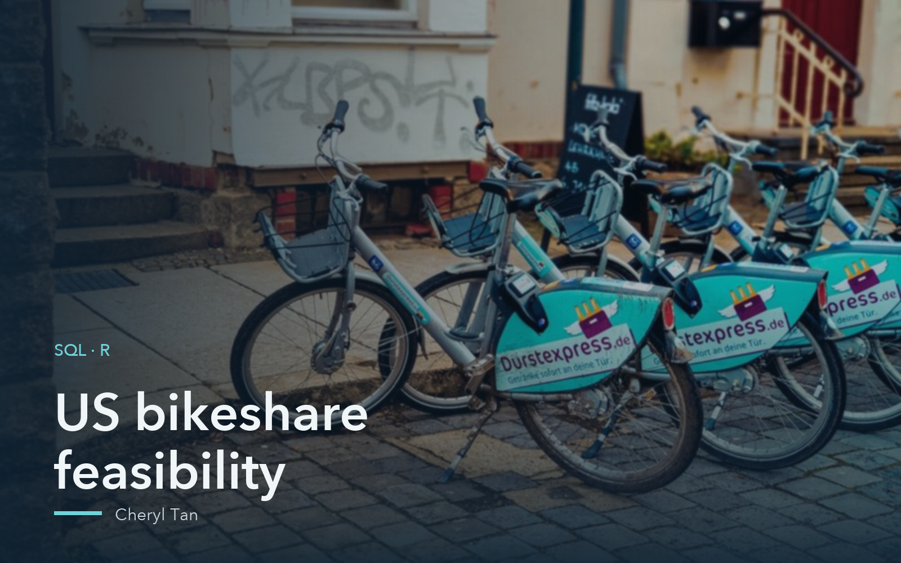
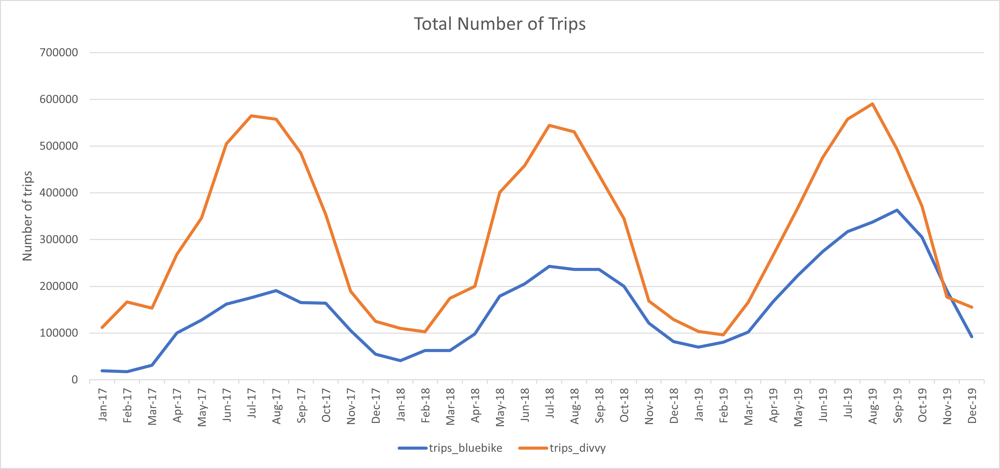

# How can bikeshare operators grow their subscriber base?

## Project background

Bluebikes (Boston) and Divvy (Chicago) are US bikeshare systems. Both sell
subscriptions and also serve casual riders who pay per trip. The decision this
analysis supports is how an operator should price, promote and resource its
service to acquire more subscribers and keep running costs under control.

I wrote the queries in SQL (PostgreSQL) and charted the results in R, working
from the operators' public trip data for 2017 to 2019. Seven business
questions are answered across three areas:

- **Demand and seasonality:** monthly trip volume, and whether riding is driven by holidays or commuting
- **Subscriptions:** the split between subscribers and casual riders, and how effective the subscription model is
- **Network and operations:** the longest and typical journey, and how often bikes must be relocated

Links to the technical work:

- Queries and results for all seven questions: [docs/METHODOLOGY.md](docs/METHODOLOGY.md)
- Charts for questions 1 to 5: [plots.rmd](plots.rmd), rendered at
  [Visualisations](https://htmlpreview.github.io/?https://raw.githubusercontent.com/cheryltky/bikeshare_studies/main/plots.html)
- Narrative report with SQL, charts and findings: [bikeshare_story.rmd](bikeshare_story.rmd)
- Question 1 chart script: [scripts/q1plots.R](scripts/q1plots.R)
- Exported results: [csvdata/](csvdata/)

## Data structure and initial checks

The data is one table of trips per company per year (Divvy and Bluebikes for
2017, 2018 and 2019), plus a station table per company with coordinates. Each
row is one trip with a start time, start and end station and a user type
(`Subscriber` or casual). Question 7 also uses Baywheels trips for 2017 and
2018. Per-year trip counts are also queried to express subscribers as a share of
all trips (question 2 in the methodology). No other validation checks or row
counts are recorded in the repository.

## Executive summary

Divvy averaged **3.7 times Bluebikes' monthly trips in 2017, narrowing to 1.5
times in 2019** as Bluebikes grew faster, and both systems peak in June to August in each of the three years. Subscribers make
up the majority of trips, but the share of casual riders is not shrinking, so
casual riders are the clearest source of new subscribers. Relocation of bikes
follows ride volume, which means operating cost peaks when demand does.

## Insights deep dive

### Demand and seasonality

- **Divvy's lead shrank from 3.7 times Bluebikes' monthly trips in 2017 to 2.1 in 2018 and 1.5 in 2019.**
  Both systems rise and fall with the seasons across the 36 months from January
  2017 to December 2019 (question 1).
- **User counts peak in June to August in every year from 2017 to 2019.** That
  pattern is more consistent with leisure riding than year-round commuting
  (question 3).

### Subscriptions

- **Subscribers are 77 to 84% of users in both cities every year.** The
  Bluebikes subscriber share slipped from 84% in 2017 to 79% in 2019
  (question 2).
- **The casual share is not shrinking.** Casual riders have already shown they
  will pay per trip, which makes them the lowest-cost target for subscription
  upgrades (questions 2 and 7).

### Network and operations

- **Divvy's longest journeys reach 27 to 37 km a year, against 11 to 16 km for
  Bluebikes.** This points to recreational
  use of the outer network. Bluebikes stations 217 and 82 were looked up as part
  of the longest-journey query (question 4).
- **Relocation events track ride volume and peak in summer.** The months that
  cost most to rebalance are the months with most revenue (question 5).
- **Average trips are short, about 1.35 to 2.45 km by season, and stable year to year.**
  The same kinds of trip happen all year, just more of them in summer
  (question 6).

## Recommendations

For the operator's pricing, marketing and operations teams:

- Peak ridership is concentrated in June to August. **Offer discounted
  subscription rates or a trial tier for the off-peak months to grow
  subscribers outside summer.**
- The casual share is not falling. **Target casual riders with upgrade
  campaigns, as they have already shown willingness to pay.**
- Relocation peaks with ride volume. **Introduce predictive rebalancing to
  reduce logistics cost in the summer months.**
- Recorded next steps: **join weather data by city and month to separate
  "summer means more riders" from "summer means better weather", and test a
  November to February price cut.**

## Assumptions and caveats

- Ratios, shares and distances above are calculated from the exported query
  results in [csvdata/](csvdata/). They differ from the earlier summary in
  [bikeshare_story.rmd](bikeshare_story.rmd), which predates the full three
  years of data. Distances are straight-line between stations, not route length.
- Question 7 has no exported result file in `csvdata/`, so its chart is not
  reproducible from the repository as it stands.
- Distance is the straight-line distance between start and end stations, not
  the distance ridden, and trips that start and end at the same station are
  excluded from the distance queries.
- A bike is counted as relocated when its next start station differs from the
  previous end station. The query orders trips by bike and start time.
- The study covers two cities and three years, so it describes these two
  systems and not the US market.

## Technical detail

- How to run it: [docs/SETUP.md](docs/SETUP.md)
- The seven questions with SQL and results: [docs/METHODOLOGY.md](docs/METHODOLOGY.md)
- Data sources: [Divvybikes](https://divvy-tripdata.s3.amazonaws.com/index.html) and [Bluebikes](https://s3.amazonaws.com/hubway-data/index.html)
